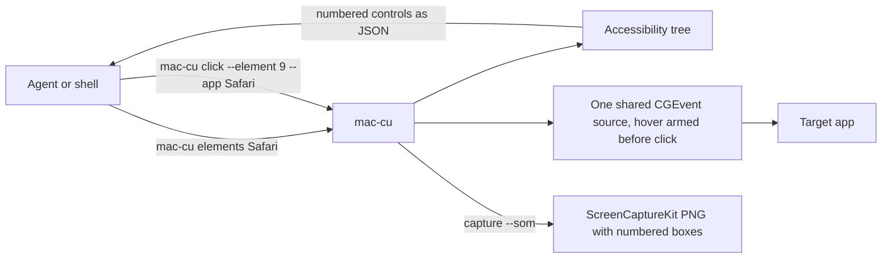

# kodros-mac-cu

A Swift command-line tool that lets an AI agent drive a Mac: list an app's controls, click them by number, type, drag, scroll and take screenshots. Every command prints one line of JSON, so an agent can read the result and check its own work.

Built for the [Kodros](https://kodros.ai) agent stack.

## How it works



Hand-written `CGEvent` and `osascript` code tends to drop mouse-ups and miss nested AppKit views. mac-cu keeps one event source, moves the pointer and waits before each click so hover state arms, and lets the agent target a control by its number in the accessibility tree instead of a pixel guess. The loop is: list controls, act on one, read state back.

## Stack

Swift with Cocoa, ApplicationServices (AX API), CoreGraphics events and ScreenCaptureKit. Two source files, no packages.

## Run

Needs macOS 14 or later on Apple Silicon, `swiftc` from Xcode or the Command Line Tools, and Accessibility permission for your terminal. `capture` also needs Screen Recording permission.

```bash
./install.sh                 # builds to ~/.local/bin/mac-cu (override with MAC_CU_BIN)
mac-cu apps
mac-cu elements Safari
mac-cu click --element 9 --app Safari
mac-cu get Safari 9
mac-cu capture /tmp/shot.png --app Safari --som
```

Full subcommand list, exit codes and safety notes: [docs/COMMANDS.md](docs/COMMANDS.md). Agent usage rules: [skill/SKILL.md](skill/SKILL.md).

Test: `swiftc JsonText.swift tests/json_text_main.swift -o /tmp/jt && /tmp/jt`.

## Status and limits

- Early. No versioned releases. Only the JSON encoder has an automated test; the GUI commands are tested by hand.
- It drives the real desktop with no sandbox, dry run or confirmation. Small blocklists stop a few destructive `type` strings and the lock and log-out shortcuts. They are a guard against mistakes, not a security boundary.
- No OCR or image analysis. macOS only.

## License

Copyright 2026 Tanner Osterkamp. All rights reserved. See [LICENSE](LICENSE). The source is public to read; ask before reuse.
